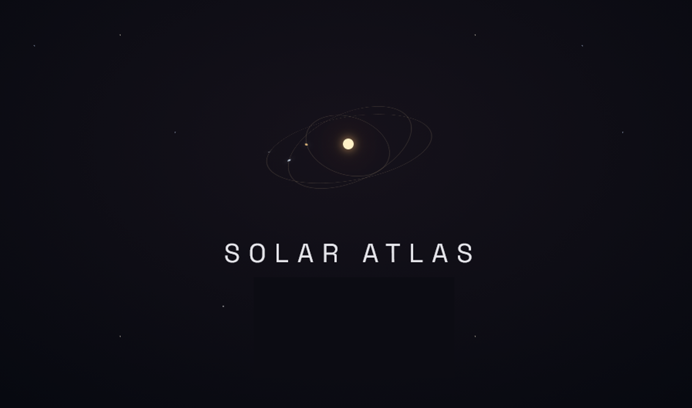
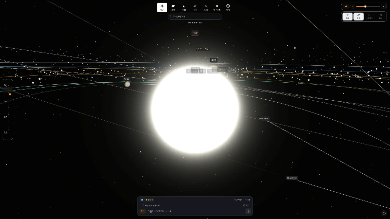
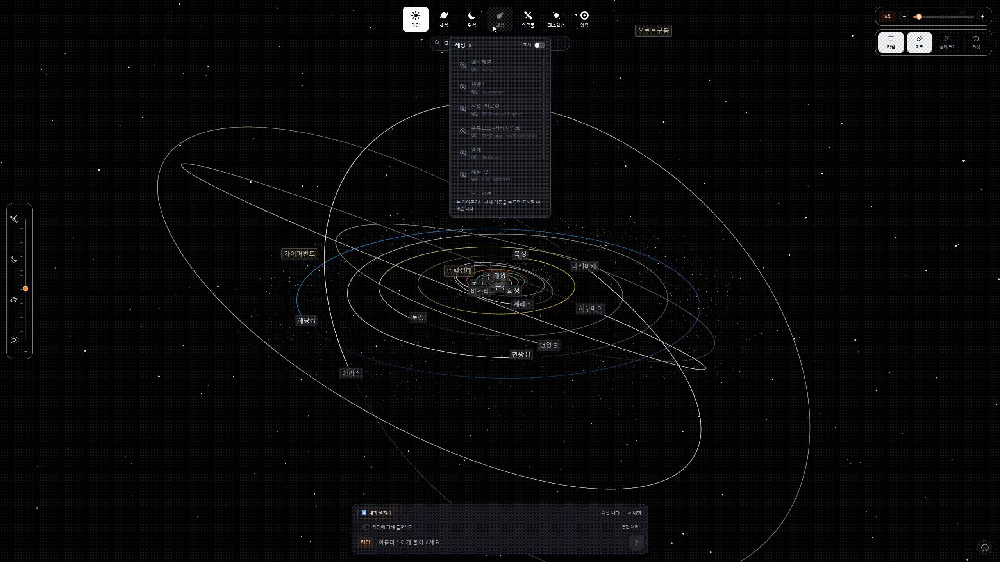
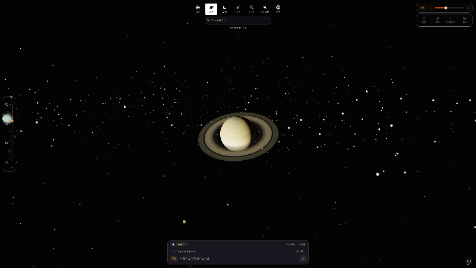
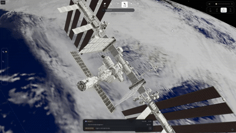
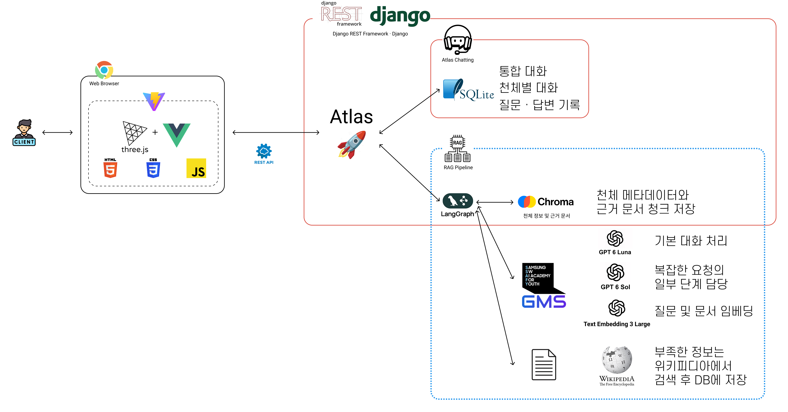
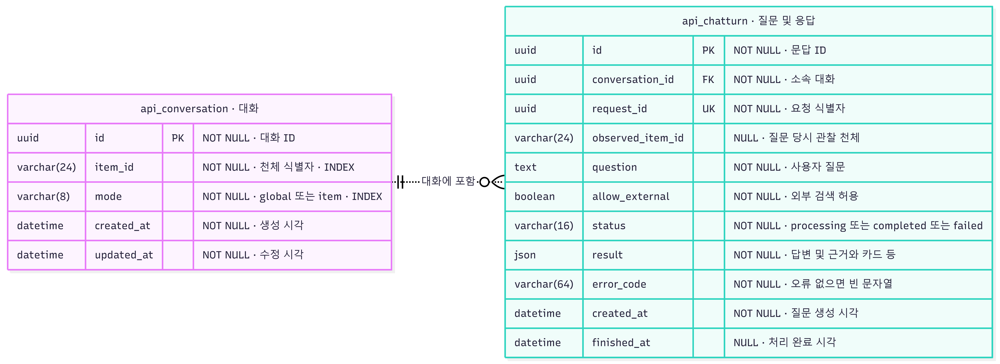
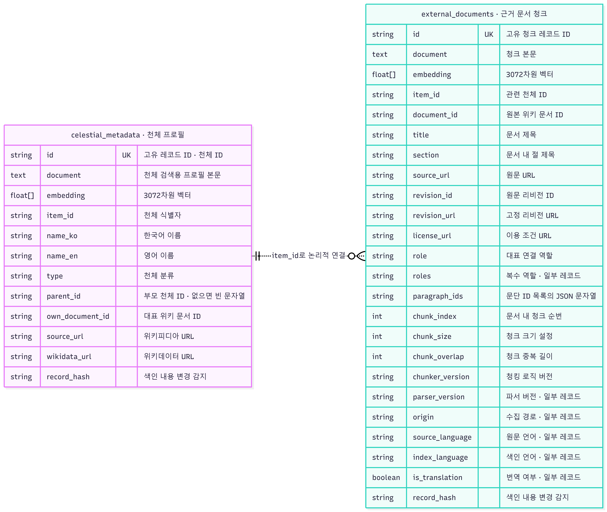

<h1 align="center">🪐 Solar Atlas</h1>
<p align="center">SSAFY AI 코어 프로젝트 · RAG 기반 도메인 지식 서비스</p>



## 📖 목차

- [서비스 소개](#introduction)
- [Demo](#demo)
- [시스템 아키텍처](#architecture)
- [ERD](#erd)
- [기술 스택](#stack)
- [실행 방법](#usage)
- [데이터 및 출처](#data)

---

<a id="introduction"></a>
## 🌌 서비스 소개

**Solar Atlas**는 태양계를 3D로 탐험하며 AI 비서 **아틀라스**에게 천체에 대해 질문하는 서비스입니다.<br>
천체·인공물·영역 100개 항목과 위키백과 문서를 Chroma에 색인하고, 검색된 근거를 바탕으로 답변합니다.

---

<a id="demo"></a>
## 📹 Demo

<table width="100%">
  <tr>
    <th width="33.33%">태양계 확대 및 축소</th>
    <th width="33.33%">시뮬레이션 속도 변경</th>
    <th width="33.33%">천체 켜고 끄기</th>
  </tr>
  <tr>
    <td align="center">
      <br>
      <a href="./data/readme_images/확대축소.mp4">▶ 확대·축소</a>
    </td>
    <td align="center">
      <br>
      <a href="./data/readme_images/시간조작.mp4">▶ 시간 조작</a>
    </td>
    <td align="center">
      <br>
      <a href="./data/readme_images/표시숨기기_전환.mp4">▶ 표시·숨기기</a>
    </td>
  </tr>
  <tr>
    <th>실제 거리 및 크기 모드</th>
    <th>RAG 질의응답</th>
    <th>RAG 조건 탐색</th>
  </tr>
  <tr>
    <td align="center">
      <br>
      <a href="./data/readme_images/실제크기.mp4">▶ 실제 크기</a>
    </td>
    <td align="center">
      <br>
      <a href="./data/readme_images/아틀라스_질의.mp4">▶ 질의응답</a>
    </td>
    <td align="center">
      <br>
      <a href="./data/readme_images/아틀라스_조건.mp4">▶ 조건 탐색</a>
    </td>
  </tr>
</table>


---

<a id="architecture"></a>
## 🛠 시스템 아키텍처



---

<a id="erd"></a>
## 🔑 ERD




---

<a id="stack"></a>
## 💻 기술 스택


| 영역           | 기술 스택                                       |  
|:-------------------:|:------------------------------------------------:|  
| **Frontend**     |     |
| **Backend**         |    |  
| **RAG & Storage**           |    | 
| **LLM**       |     |  
| **Additional**           |  | 

---

<a id="usage"></a>
## 🚀 실행 방법

권장 환경: **Python 3.11, Node.js 22.12 이상**

### 1. Python 환경과 API 키

```powershell
python -m venv venv
source venv/Scripts/activate
python -m pip install -r requirements.txt
```

`src/crawling/.env`에 발급받은 키를 입력합니다.

```dotenv
GMS_KEY=your_gms_key
WIKI_CONTACT=your_email@example.com
```

### 2. 백엔드

새로운 터미널을 열어주세요.
기존 터미널은 계속 열린 상태로 유지해주세요.

```powershell
cd backend
python manage.py migrate
python manage.py runserver
```

주소: `http://127.0.0.1:8000`

### 3. 프론트엔드

새로운 터미널을 열어주세요.
기존 터미널은 계속 열린 상태로 유지해주세요.

```powershell
cd frontend
npm install
npm run dev
```

주소: `http://localhost:5173`.

### 4. 데이터 준비·색인

- 제출용 데이터: `data/solar_v1/processed/`
- 실행 데이터: `src/crawling/data/solar_v1/processed/`
- Vector DB: `src/backend/chroma_db/`

제공된 Chroma를 사용하면 초기 색인은 생략합니다. 재구축할 때만 `src/backend`에서 실행합니다.

```powershell
python manage.py index_solar --group all --include-english-originals --dry-run
python manage.py index_solar --group all --include-english-originals
```

실제 색인은 GMS 임베딩 사용량이 발생합니다. 영어 문서는 번역문이 아닌 **영어 원문**으로 등록합니다.
수집 코드는 `src/crawling/collect.py`, 청킹·색인 설정은 `src/backend/config/settings.py`에 있습니다.

---

<a id="data"></a>
## 📚 데이터 및 출처

### 제출 데이터

| 항목 | 규모 |
|---|---:|
| 천체 | 100개 |
| 문서 | 174개 · 한국어 164개 / 영어 10개 |
| 추출 사실 | 2,342개 |
| 청킹 설정 | 최대 1,000자 / 중첩 150자 |
| Chroma 컬렉션 | `celestial_metadata` / `external_documents` |

### 출처·이용 조건

| 자료 | 출처·이용 조건 |
|---|---|
| 설명 문서 | 한국어·영어 위키백과. 문서별 출처·라이선스 URL은 `documents.json`에 기록 |
| 항목 속성 | Wikidata. 속성별 원본 진술·출처 정보 보존 |
| 궤도·위치 참고 | NASA/JPL SBDB·Horizons, 관련 관측·연구 자료 |
| 3D 모델·텍스처 | NASA, ESA, Sketchfab, Wikimedia 등. 자산별 저작자·라이선스·수정 내역 개별 기록 |
| 시각화 원본 | 원본 React 프로젝트인 [nbetts/model-solar-system](https://github.com/nbetts/model-solar-system)을 Vue 프로젝트로 리팩토링 |

각 데이터 별 조건은 아래 문서와 앱의 정보 버튼에서 확인할 수 있습니다.

- [인공물 모델 출처](src/frontend/public/assets/models/CREDITS.html)
- [자연 천체 모델 출처](src/frontend/public/assets/models/natural/CREDITS.html)
- [텍스처 출처](src/frontend/public/assets/planet-texture-maps/CREDITS.html)
- [기존 상세 기록·저작권 고지](README_legacy.md)
