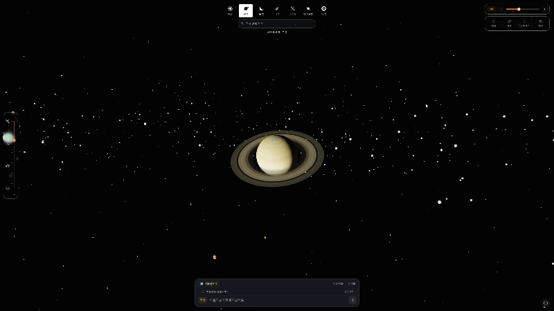
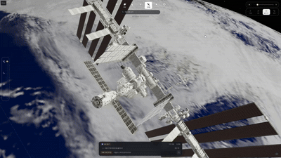
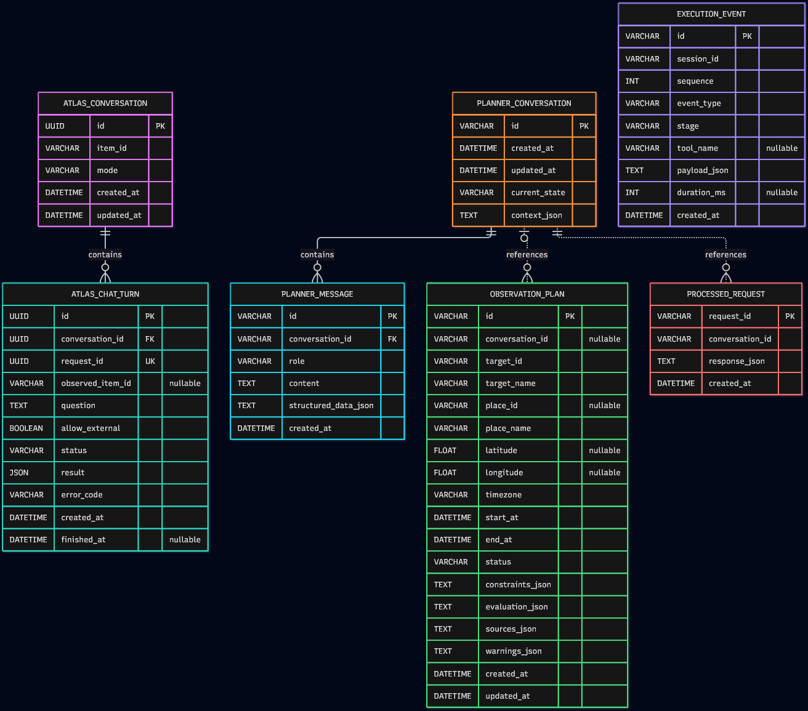

<h1 align="center">
  <a href="https://nekerworld.github.io/Solar-Atlas/">🪐 Solar Atlas</a>
</h1>
<p align="center">SSAFY AI 코어 프로젝트 · 3D 태양계, 지상 천구(플라네타리움), 관측 플래너</p>


## 📖 목차

- [서비스 소개](#introduction)
- [Demo](#demo)
- [시스템 아키텍처](#architecture)
- [ERD](#erd)
- [기술 스택](#stack)
- [실행 방법](#usage)
- [데이터 및 출처](#data)

---

<a id="introduction"></a>
## 🌌 서비스 소개

**Solar Atlas**는 태양계를 3D로 둘러보고, 지금 서 있는 자리에서 올려다본 하늘을 천구로 보며, AI 비서에게 관측 계획과 천체 지식을 묻는 서비스입니다. (천체 지식 RAG 시스템은 현재 OpenAI 서버 이상으로 인해 제대로 동작하지 않을 수 있습니다.)

서비스는 크게 세 화면으로 구성되어있고, 새로고침하면 항상 태양계로 들어옵니다.

| 화면 | 하는 일 |
|---|---|
| **태양계** | Three.js로 천체 궤도·크기·표시를 조작합니다. 왼쪽 아래 **지상 관측**으로 천구에 들어갑니다. |
| **지상 천구(플라네타리움)** | 내 위치와 시각의 하늘입니다. 별·행성·달·별자리·소천체를 고르고, 낮밤을 흘려 봅니다. 행성·달을 고르면 **이 천체 관측하기**로 플래너에 넘깁니다. |
| **관측 플래너** | 장소·천문력·날씨 Tool로 관측 계획을 세웁니다. 조건이 안 맞으면 최대 3번 다시 계획합니다. 천체 지식 질문은 2차 RAG 검색 Tool로 답하고 근거 링크를 보여 줍니다. |

태양계 화면의 천체별 "이 천체 관측하기"는 없습니다. 관측 대상은 천구에서 고릅니다. 천체 지식 대화(아틀라스)는 기본으로 숨겨져 있고, 백엔드를 붙일 때만 다시 켭니다.

---

<a id="demo"></a>
## 📹 Demo

<table width="100%">
  <tr>
    <th width="33.33%">태양계 확대 및 축소</th>
    <th width="33.33%">시뮬레이션 속도 변경</th>
    <th width="33.33%">천체 켜고 끄기</th>
  </tr>
  <tr>
    <td align="center">
      <br>
      <a href="./data/readme_media/확대축소.mp4">▶ 확대·축소</a>
    </td>
    <td align="center">
      <br>
      <a href="./data/readme_media/시간조작.mp4">▶ 시간 조작</a>
    </td>
    <td align="center">
      <br>
      <a href="./data/readme_media/표시숨기기_전환.mp4">▶ 표시·숨기기</a>
    </td>
  </tr>
  <tr>
    <th>실제 거리 및 크기 모드</th>
    <th>RAG 질의응답</th>
    <th>천구 탐색 및 별자리</th>
  </tr>
  <tr>
    <td align="center">
      <br>
      <a href="./data/readme_media/실제크기.mp4">▶ 실제 크기</a>
    </td>
    <td align="center">
      <br>
      <a href="./data/readme_media/아틀라스_질의.mp4">▶ 질의응답</a>
    </td>
    <td align="center">
      <br>
      <a href="./data/readme_media/천구.mp4">▶ 천구 탐색</a>
    </td>
  </tr>
  <tr>
    <th>소천체·궤도</th>
    <th>관측 일정과 플래너</th>
    <th>화면 전환</th>
  </tr>
  <tr>
    <td align="center">
      <br>
      <a href="./data/readme_media/천체_플래너.mp4">▶ 소천체</a>
    </td>
    <td align="center">
      <br>
      <a href="./data/readme_media/관측_플래너.mp4">▶ 플래너</a>
    </td>
    <td align="center">
      <br>
      <a href="./data/readme_media/화면전환.mp4">▶ 화면 전환</a>
    </td>
  </tr>
</table>

---

<a id="architecture"></a>
## 🛠 시스템 아키텍처


---

<a id="erd"></a>
## 🔑 ERD



---

<a id="stack"></a>
## 💻 기술 스택

| 영역 | 기술 스택 |
|:---|:---|
| **Frontend** |      |
| **Backend** |     |
| **RAG & Agent** |     |
| **LLM** |    |
| **Additional** |   |

---

<a id="usage"></a>
## 🚀 실행 방법

권장 환경: **Python 3.11 이상, Node.js 22.12 이상**

| 서버 | 폴더 | 포트 | 하는 일 |
|---|---|---:|---|
| 프론트엔드 | `frontend` | 5173 | 태양계, 지상 천구, 관측 플래너 화면 |
| 지식 검색 백엔드 | `backend` | 8000 | RAG 검색. 플래너의 `search_knowledge` Tool이 호출 |
| 플래너 백엔드 | `planner_backend` | 8001 | Agent, Tool, 천구 위치·궤도, 계획 저장, 실행 로그 |

```bash
node scripts/dev.mjs
```

실행 순서는 **지식 검색 백엔드(8000) → 플래너 백엔드(8001) → 프론트엔드(5173)** 입니다. 
<br>앞 서버가 응답해야 다음 서버를 켜고, 세 서버가 모두 준비되면 브라우저에서 `http://127.0.0.1:5173/Solar-Atlas/`를 열어주세요.

---

<a id="data"></a>
## 📚 데이터 및 출처

### 제출 데이터

| 항목 | 규모 |
|---|---:|
| 천체 | 100개 |
| 문서 | 174개 · 한국어 164개 / 영어 10개 |
| 추출 사실 | 2,342개 |
| 청킹 설정 | 최대 1,000자 / 중첩 150자 |
| Chroma 컬렉션 | `celestial_metadata` / `external_documents` |
| 현재 색인 폴더 | `backend/chroma_db_gemini` (`gemini-embedding-2`, 3072차원). 색인 전 |
| 화면용 별·별자리 | 밝은 별 약 30개와 북극성, 대표 별자리 중심. 이름표는 별자리 88개와 고유 이름 별 |

### 출처·이용 조건

| 자료 | 출처·이용 조건 |
|---|---|
| 설명 문서 | 한국어·영어 위키백과. 문서별 출처·라이선스 URL은 `documents.json`에 기록 |
| 항목 속성 | Wikidata. 속성별 원본 진술·출처 정보 보존 |
| 궤도·위치 | NASA/JPL Horizons. 천구 소천체 적경·적위와 궤도 요소도 여기. 브라우저에서 직접 부르지 않음 |
| 예보 | Open-Meteo (CC BY 4.0) |
| 장소 | Google Places API (New). 지도 없이 쓸 때 출처 표시 |
| 보이는 일정·탐색 위치 | astronomy-engine. 최종 적합 판정은 Horizons |
| 별자리 경계 | d3-celestial 자료, BSD-3-Clause (`frontend/sky/constellationBounds.js`) |
| 별자리 그림 | Stellarium `modern` 문화권, Free Art License. [`frontend/public/constellation-art/NOTICE.md`](frontend/public/constellation-art/NOTICE.md) |
| 보도블록 텍스처 | Dreamstime 사진(작가 JaCrispy)을 이음매 없는 타일로 가공. 상업적 이용은 라이선스를 따로 확인 |
| 3D 모델·텍스처 | NASA, ESA, Sketchfab, Wikimedia 등. 자산별 저작자·라이선스·수정 내역 개별 기록 |
| 시각화 원본 | 원본 React 프로젝트인 [nbetts/model-solar-system](https://github.com/nbetts/model-solar-system)을 Vue 프로젝트로 리팩토링 |
| 천구 엔진 | 이 저장소 밖의 `atlas-engine`. `npm run build:sky`로만 포함하고 소스에 커밋하지 않음 |

각 데이터 별 조건은 아래 문서와 앱의 정보 버튼에서 확인할 수 있습니다.

- [인공물 모델 출처](frontend/public/assets/models/CREDITS.html)
- [자연 천체 모델 출처](frontend/public/assets/models/natural/CREDITS.html)
- [텍스처 출처](frontend/public/assets/planet-texture-maps/CREDITS.html)
- [외부 API·라이선스](docs/SOURCES_AND_LICENSES.md)
- [기존 상세 기록·저작권 고지](README_legacy.md)