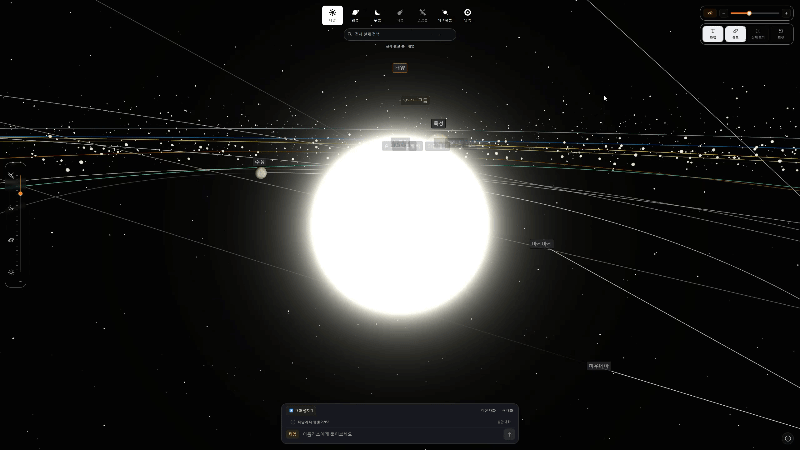
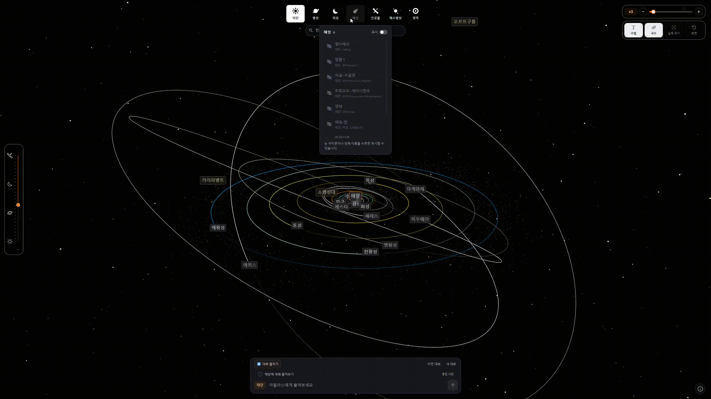
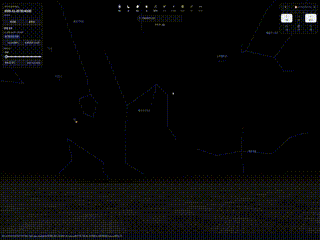
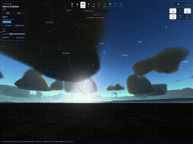
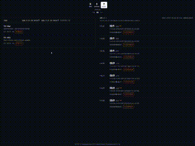
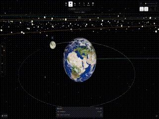
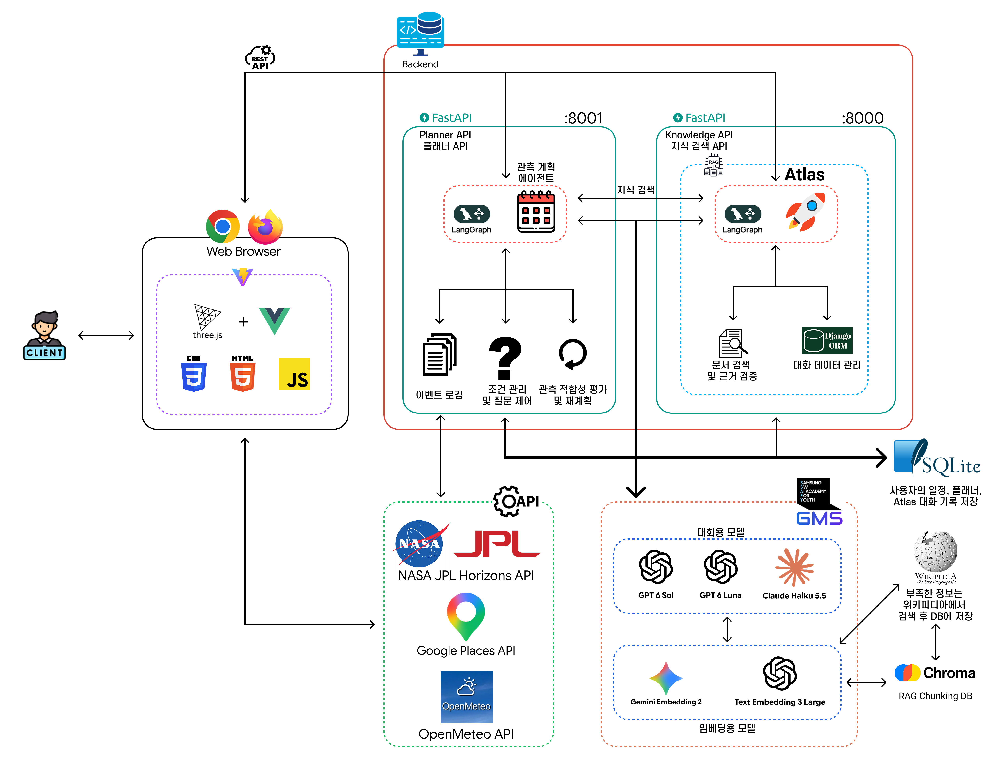
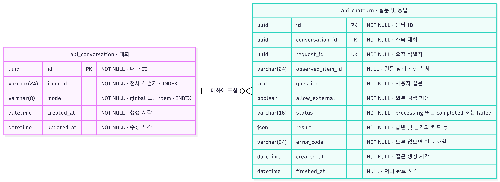
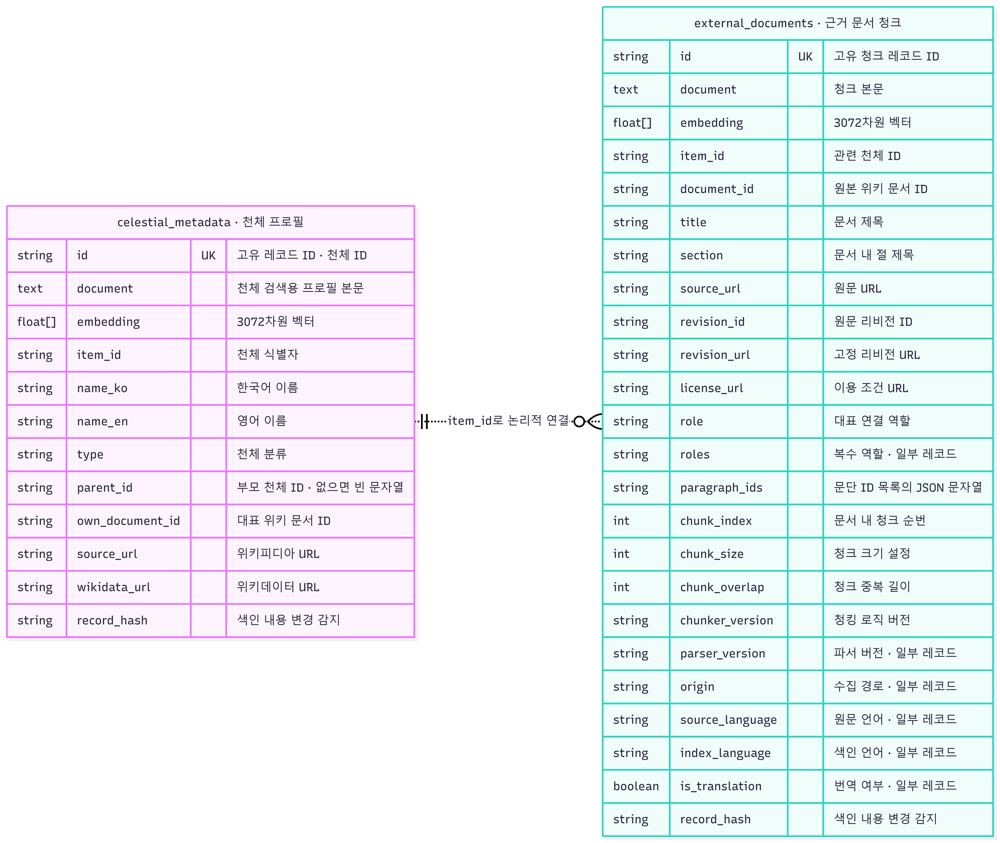
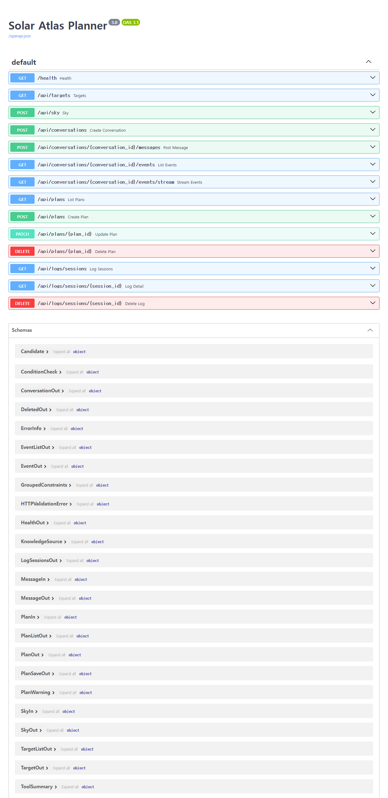

<h1 align="center">
  <a href="https://nekerworld.github.io/Solar-Atlas/">🪐 Solar Atlas</a>
</h1>
<p align="center">SSAFY AI 코어 프로젝트 · 3D 태양계, 지상 천구(플라네타리움), 관측 플래너</p>


GitLab의 한계로 인해 README의 일부가 의도와 달리 보일 수 있습니다.<br>
[GitHub](https://github.com/Nekerworld/Solar-Atlas)로 보시는 것을 추천드립니다.

## 📖 목차

- [서비스 소개](#introduction)
- [Demo](#demo)
- [시스템 아키텍처](#architecture)
- [ERD](#erd)
- [기술 스택](#stack)
- [실행 방법](#usage)
- [지상 천구](#ground)
- [관측 플래너](#planner)
- [데이터 및 출처](#data)

---

<a id="introduction"></a>
## 🌌 서비스 소개

**Solar Atlas**는 태양계를 3D로 둘러보고, 지금 서 있는 자리에서 올려다본 하늘을 천구로 보며, AI 비서에게 관측 계획과 천체 지식을 묻는 서비스입니다. (천체 지식 RAG 시스템은 현재 OpenAI 서버 이상으로 인해 제대로 동작하지 않을 수 있습니다.)

서비스는 크게 세 화면으로 구성되어있고, 새로고침하면 항상 태양계로 들어옵니다.

| 화면 | 하는 일 |
|---|---|
| **태양계** | Three.js로 천체 궤도·크기·표시를 조작합니다. 왼쪽 아래 **지상 관측**으로 천구에 들어갑니다. |
| **지상 천구(플라네타리움)** | 내 위치와 시각의 하늘입니다. 별·행성·달·별자리·소천체를 고르고, 낮밤을 흘려 봅니다. 행성·달을 고르면 **이 천체 관측하기**로 플래너에 넘깁니다. |
| **관측 플래너** | 장소·천문력·날씨 Tool로 관측 계획을 세웁니다. 조건이 안 맞으면 최대 3번 다시 계획합니다. 천체 지식 질문은 2차 RAG 검색 Tool로 답하고 근거 링크를 보여 줍니다. |

태양계 화면의 천체별 "이 천체 관측하기"는 없습니다. 관측 대상은 천구에서 고릅니다. 천체 지식 대화(아틀라스)는 기본으로 숨겨져 있고, 백엔드를 붙일 때만 다시 켭니다.

---

<a id="demo"></a>
## 📹 Demo

<table width="100%">
  <tr>
    <th width="33.33%">태양계 확대 및 축소</th>
    <th width="33.33%">시뮬레이션 속도 변경</th>
    <th width="33.33%">천체 켜고 끄기</th>
  </tr>
  <tr>
    <td align="center">
      <br>
      <a href="./data/readme_media/확대축소.mp4">▶ 확대·축소</a>
    </td>
    <td align="center">
      <br>
      <a href="./data/readme_media/시간조작.mp4">▶ 시간 조작</a>
    </td>
    <td align="center">
      <br>
      <a href="./data/readme_media/표시숨기기_전환.mp4">▶ 표시·숨기기</a>
    </td>
  </tr>
  <tr>
    <th>실제 거리 및 크기 모드</th>
    <th>RAG 질의응답</th>
    <th>천구 탐색 및 별자리</th>
  </tr>
  <tr>
    <td align="center">
      <br>
      <a href="./data/readme_media/실제크기.mp4">▶ 실제 크기</a>
    </td>
    <td align="center">
      <br>
      <a href="./data/readme_media/아틀라스_질의.mp4">▶ 질의응답</a>
    </td>
    <td align="center">
      <br>
      <a href="./data/readme_media/천구.mp4">▶ 천구 탐색</a>
    </td>
  </tr>
  <tr>
    <th>소천체·궤도</th>
    <th>관측 일정과 플래너</th>
    <th>화면 전환</th>
  </tr>
  <tr>
    <td align="center">
      <br>
      <a href="./data/readme_media/천체_플래너.mp4">▶ 소천체</a>
    </td>
    <td align="center">
      <br>
      <a href="./data/readme_media/관측_플래너.mp4">▶ 플래너</a>
    </td>
    <td align="center">
      <br>
      <a href="./data/readme_media/화면전환.mp4">▶ 화면 전환</a>
    </td>
  </tr>
</table>

---

## 🛠 시스템 아키텍처

> 시간이 없어 수정하지 못했습니다. 향후 수정하여 깃허브에 푸쉬하겠습니다.



---

## 🔑 ERD

> 시간이 없어 수정하지 못했습니다. 향후 수정하여 깃허브에 푸쉬하겠습니다.




---

## 🛠 docs/



---

<a id="stack"></a>
## 💻 기술 스택

| 영역 | 기술 스택 |
|:---:|:---:|
| **Frontend** |      |
| **Backend** |     |
| **RAG & Agent** |     |
| **LLM** |    |
| **Additional** |   |

---

<a id="usage"></a>
## 🚀 실행 방법

권장 환경: **Python 3.11 이상, Node.js 22.12 이상**

서버는 셋입니다. 1~2번(환경, 천구 번들)을 한 번 준비한 뒤에는 명령 하나로 모두 띄웁니다(3번). 서버를 따로 띄우려면 4~6번을 봅니다.

| 서버 | 폴더 | 포트 | 하는 일 |
|---|---|---:|---|
| 프론트엔드 | `frontend` | 5173 | 태양계, 지상 천구, 관측 플래너 화면 |
| 지식 검색 백엔드 | `backend` | 8000 | RAG 검색. 플래너의 `search_knowledge` Tool이 호출 |
| 플래너 백엔드 | `planner_backend` | 8001 | Agent, Tool, 천구 위치·궤도, 계획 저장, 실행 로그 |

### 1. Python 환경과 API 키

```powershell
python -m venv venv
venv\Scripts\activate
python -m pip install -r requirements.txt -r planner_backend/requirements.txt
```

키는 파일로만 넣고 소스나 화면, 로그에 남기지 않습니다. `.env`는 Git에서 제외되어 있습니다.

| 파일 | 키 | 용도 |
|---|---|---|
| 저장소 루트 `.env` | `GMS_KEY` (없으면 `GMS_API_KEY`) | SSAFY GMS. 플래너 의도 분석·계획, 지식 검색·챗봇 답변, 질문 임베딩, 크롤링 LLM이 이 키를 읽는다. |
| 저장소 루트 `.env` | `GOOGLE_MAPS_API_KEY` | Google Places API (New). 장소 검색·상세. 천구의 장소 찾기도 같은 키를 쓴다. |
| 저장소 루트 `.env` | `WIKI_CONTACT` | 크롤링(`crawling/collect.py`)의 Wikipedia 요청 연락처 |

LLM(의도 분석, 작업 계획, 답변 생성, 크롤링 번역)은 GMS의 Anthropic 호환 경로(`https://gms.ssafy.io/gmsapi/api.anthropic.com/v1/chat/completions`)로 `claude-haiku-5-5`를 부릅니다. 임베딩은 GMS의 Gemini 경로(`gemini-embedding-2`, 3072차원)입니다. 엔드포인트와 모델은 코드에 고정되어 있고 환경변수로 바꾸지 않습니다. 이미 설정된 OS 환경변수가 `.env`보다 우선합니다.

Horizons와 Open-Meteo는 키가 필요 없습니다. 플래너 설정 목록은 `planner_backend/.env.example`, 프론트 주소는 `frontend/.env.example`에 있습니다.

### 2. 한 번에 실행

터미널 하나에서 실행하며, 운영체제나 셸(PowerShell, Git Bash, macOS/Linux)과 상관없이 같은 방법으로 실행할 수 있습니다.

```bash
node scripts/dev.mjs
```

실행 순서는 **지식 검색 백엔드(8000) → 플래너 백엔드(8001) → 프론트엔드(5173)** 입니다. 앞 서버가 응답해야 다음 서버를 띄우고, 셋이 모두 준비되면 브라우저에서 `http://127.0.0.1:5173/Solar-Atlas/`를 엽니다. 세 서버의 로그는 `[backend]`, `[planner]`, `[frontend]` 머리말을 붙여 한 터미널에 함께 나옵니다.

- `venv/`가 있으면 그 Python을 쓰므로 가상환경을 따로 활성화하지 않아도 됩니다. 없으면 시스템 Python을 씁니다.
- `frontend/node_modules`가 없으면 `npm install`을 먼저 실행합니다.
- 한 서버라도 뜨지 못하면(프로세스 종료, 120초 안에 응답 없음, 포트가 이미 사용 중) 마지막 출력을 보여 주고 나머지도 모두 종료합니다.
- **종료는 `Ctrl+C`** 한 번이면 세 서버가 함께 꺼집니다.
- 옵션: `--no-open`(브라우저를 열지 않음), `--timeout=<초>`(서버 하나를 기다리는 시간, 기본 120).

---

<a id="ground"></a>
## 🌍 지상 천구

태양계 왼쪽 아래 **지상 관측**, 또는 플래너 머리말의 **플라네타리움**으로 들어갑니다. 브라우저 위치를 허용하면 그 좌표와 현재 시각으로 시작하고, 거부하면 서울을 쓰되 화면에 "내 위치 아님"을 밝힙니다. 좌표는 하늘을 그릴 때 화면 안에서 쓰고, 대상 고도·날씨를 확인할 때와 장소 이름을 찾을 때 플래너 서버로 보내 Horizons·예보·Places를 조회합니다. 관측 계획에서 들어오면 그 계획의 장소·시각을 씁니다.

하늘(별·행성·태양·달·대기·별자리선)은 천구 엔진이 그립니다. 발밑은 도시 보도블록 원판이고, 둘레에는 장소마다 다른 산줄기 세 겹이 있습니다. 드래그로 시선을 돌리고, 휠로 시야를 바꿉니다. 지평선은 수평을 유지합니다.

| 조작 | 위치 | 내용 |
|---|---|---|
| 천체 탐색 | 위쪽 가운데 | 태양·달, 행성(명왕성 포함), 별, 별자리, 검색. 위성·왜소행성·소행성·혜성·탐사선은 Horizons 위치가 오면 분류에 붙습니다. |
| 속도·표시 | 오른쪽 위 | 일시정지·실시간·1분/초·10분/초·1시간/초·1일/초. 라벨, 궤도, 별자리선, 구름, 적도 격자. 스페이스바로 멈춥니다. |
| 조건 | 왼쪽 위 | 시선, 태양 고도(낮·박명·밤), 하루 시간, 시각·위도·경도·고도·장소 검색. |
| 이름표 클릭 | 하늘 | 행성·달이면 **이 천체 관측하기**. 별·별자리·태양은 플래너 대상이 아닌 이유를 보여 줍니다. |

궤도 토글을 켜면 황도선이 항상 보이고, 천체 궤도선은 그 천체를 클릭했을 때만 그 천체 것이 나옵니다. 별자리 이름표에 마우스를 올리면 그림이 희미하게 뜹니다. 이름표는 한국어입니다. 소천체 위치는 `GET /api/sky/bodies`(30일, 2시간 간격, 이후 캐시)이고, 못 받은 천체는 이유를 남기며 값을 만들지 않습니다.

앞으로 7일의 "내 위치에서 보이는 일정"은 플래너에서 astronomy-engine으로 미리 보여 줍니다. 계획을 만들 때의 최종 적합 판정은 Horizons와 예보입니다. 일정에서 "이 시간으로 계획 요청 쓰기"와 "이 시간 천구에서 보기"로 이어집니다.

---

<a id="planner"></a>
## 🔭 관측 플래너

"이번 토요일 서울숲에서 목성을 보고 싶어"처럼 말하면, Agent가 요청을 분석하고 Tool을 호출해 관측 장소와 시간대를 추천합니다. 충족하는 후보가 없으면 시간대나 장소를 바꿔 최대 3번 다시 계획하고, 못 구하면 이유를 사실대로 알립니다. 값을 만들어 채우지 않으며, 확인하지 못한 조건은 `UNVERIFIED`로 표시합니다.

천구에서 행성·달을 고르고 **이 천체 관측하기**를 누르면 그 천체가 선택된 채로 플래너가 열립니다. 천체를 고른 채 들어오면 대화 옆에 앞으로 7일의 보이는 일정이 함께 열립니다. 천체 지식 질문(예: "목성은 얼마나 큰 행성이야?")은 같은 대화에서 RAG 검색 Tool로 처리하고 근거 문서 링크를 보여 줍니다. 머리말에서 태양계와 플라네타리움으로 돌아갈 수 있습니다.

### Agent와 Tool

| Tool | 외부 API | 키 | 상태 |
|---|---|---|---|
| `search_places`, `get_place_details` | Google Places API (New) | `GOOGLE_MAPS_API_KEY` | 실호출 검증 |
| `get_ephemeris` | NASA JPL Horizons | 없음 | 실호출 검증. 천구의 소천체 위치·궤도도 같은 API |
| `get_weather` | Open-Meteo | 없음 | 실호출 검증 |
| `search_knowledge` | 자체 RAG 검색(8000) | `GMS_KEY` | 질문 임베딩은 `gemini-embedding-2`. 새 색인(`chroma_db_gemini`)을 만들기 전에는 근거 문서를 돌려주지 못함 |
| `get_route` | Google Routes | 같은 키 | **제외.** 응답이 비어 `PLANNER_ROUTES_ENABLED=false` |

메인 Agent(LangGraph)가 분석 → 계획 → Tool 호출 → 평가·재계획 → 응답을 맡고, 로깅 Agent는 이벤트를 구독해 저장합니다(LLM을 부르지 않음). 구조는 [`docs/AGENT_WORKFLOW.md`](docs/AGENT_WORKFLOW.md)에 있습니다.

---

<a id="data"></a>
## 📚 데이터 및 출처

### 제출 데이터

| 항목 | 규모 |
|---|---:|
| 천체 | 100개 |
| 문서 | 174개 · 한국어 164개 / 영어 10개 |
| 추출 사실 | 2,342개 |
| 청킹 설정 | 최대 1,000자 / 중첩 150자 |
| Chroma 컬렉션 | `celestial_metadata` / `external_documents` |
| 현재 색인 폴더 | `backend/chroma_db_gemini` (`gemini-embedding-2`, 3072차원). 색인 전 |
| 화면용 별·별자리 | 밝은 별 약 30개와 북극성, 대표 별자리 중심. 이름표는 별자리 88개와 고유 이름 별 |

### 출처·이용 조건

| 자료 | 출처·이용 조건 |
|---|---|
| 설명 문서 | 한국어·영어 위키백과. 문서별 출처·라이선스 URL은 `documents.json`에 기록 |
| 항목 속성 | Wikidata. 속성별 원본 진술·출처 정보 보존 |
| 궤도·위치 | NASA/JPL Horizons. 천구 소천체 적경·적위와 궤도 요소도 여기. 브라우저에서 직접 부르지 않음 |
| 예보 | Open-Meteo (CC BY 4.0) |
| 장소 | Google Places API (New). 지도 없이 쓸 때 출처 표시 |
| 보이는 일정·탐색 위치 | astronomy-engine. 최종 적합 판정은 Horizons |
| 별자리 경계 | d3-celestial 자료, BSD-3-Clause (`frontend/sky/constellationBounds.js`) |
| 별자리 그림 | Stellarium `modern` 문화권, Free Art License. [`frontend/public/constellation-art/NOTICE.md`](frontend/public/constellation-art/NOTICE.md) |
| 보도블록 텍스처 | Dreamstime 사진(작가 JaCrispy)을 이음매 없는 타일로 가공. 상업적 이용은 라이선스를 따로 확인 |
| 3D 모델·텍스처 | NASA, ESA, Sketchfab, Wikimedia 등. 자산별 저작자·라이선스·수정 내역 개별 기록 |
| 시각화 원본 | 원본 React 프로젝트인 [nbetts/model-solar-system](https://github.com/nbetts/model-solar-system)을 Vue 프로젝트로 리팩토링 |
| 천구 엔진 | 이 저장소 밖의 `atlas-engine`. `npm run build:sky`로만 포함하고 소스에 커밋하지 않음 |

각 데이터 별 조건은 아래 문서와 앱의 정보 버튼에서 확인할 수 있습니다.

- [인공물 모델 출처](frontend/public/assets/models/CREDITS.html)
- [자연 천체 모델 출처](frontend/public/assets/models/natural/CREDITS.html)
- [텍스처 출처](frontend/public/assets/planet-texture-maps/CREDITS.html)
- [외부 API·라이선스](docs/SOURCES_AND_LICENSES.md)
- [기존 상세 기록·저작권 고지](README_legacy.md)

## 프론트엔드만 배포

백엔드 없이 `frontend`의 정적 파일만 배포할 수 있습니다. GitHub Pages 워크플로는 아틀라스를 끄고 프론트만 빌드합니다. 천구 번들(`npm run build:sky`)은 그 워크플로에 없으므로, 배포본에서 지상 모드는 번들을 미리 `frontend/public/sky/`에 넣어 빌드할 때만 하늘이 보입니다.

```sh
cd frontend
npm ci
npm run build
```

생성된 `frontend/dist`를 배포합니다. 현재 Vite 기본 경로는 GitHub Pages용 `/Solar-Atlas/`입니다. 다른 경로에 배포할 때는 `npm run build -- --base=/`처럼 배포 경로를 지정합니다. 로딩은 정적 텍스처와 3D 모델, 천구 준비, 첫 프레임을 기다립니다. 천구 준비가 실패해도 태양계 화면은 열립니다.

아틀라스 검색·대화 UI는 기본적으로 숨겨지며 대화 복원 API도 호출하지 않습니다. 백엔드와 검색 코드는 유지됩니다. 다시 사용할 때는 `frontend/.env.local`에 `VITE_ENABLE_ATLAS=true`와 `VITE_API_BASE_URL`을 설정하고 재시작 또는 재빌드합니다.

배포 빌드 검증(Chrome 설치 필요):

```sh
cd frontend
npm run build
npx playwright test --config playwright.deployment.config.js
```

이 검증은 백엔드 API를 차단한 상태에서 화면 로딩, 검색 UI 숨김, 천체 선택 및 배포 경로의 출처 링크를 확인합니다.
