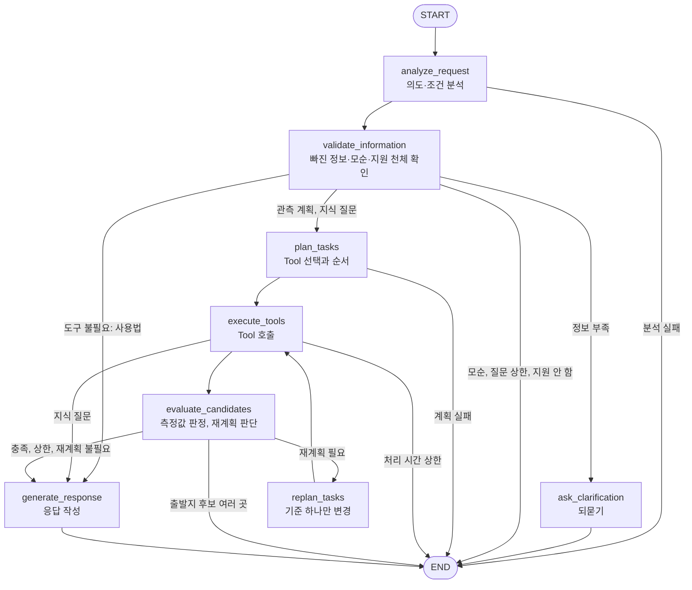

# Agent 설계

## 구성

- **메인 Agent**: LangGraph(1.2.12) `StateGraph`다. 노드마다 한 단계의 일을 하고, 노드 사이는 조건 분기로 잇는다. 코드는 `planner_backend/app/engine.py`(그래프, 노드, 재계획 판단), `fsm.py`(조건 병합, 되묻기), `evaluator.py`(수치 판정), `llm.py`(의도 분석, 작업 계획)에 있다.
- **로깅 Agent**: 메인 Agent가 내보내는 이벤트를 구독해 저장한다. LLM을 부르지 않는다. 코드는 `logging_agent.py`다.
- **Tool**: `planner_backend/app/tools/`에 있다. 명세는 `docs/TOOL_SPEC.md`다.

## 흐름

그림은 `PLANNER_GRAPH.get_graph().draw_mermaid()`가 그리는 구조와 같다. 응답의 `graph_path`에 그 요청이 실제로 지나간 노드 순서가 들어간다. 예를 들어 재계획이 한 번 있었던 요청은 `analyze_request → validate_information → plan_tasks → execute_tools → evaluate_candidates → replan_tasks → execute_tools → evaluate_candidates → generate_response`다.

- **사용법 질문**(`help`)은 `validate_information`에서 바로 `generate_response`로 간다. Tool을 호출하지 않는다.
- **지식 질문**(`ask_knowledge`)은 `plan_tasks`가 `search_knowledge` 하나만 고르고, `execute_tools`가 부른 뒤 판정 없이 응답한다. 답을 지어내지 않고, 실패하면 이유를 안내 문장으로만 알린다.
- **관측 계획**(`plan_observation`)은 장소 검색 → 장소 상세 → 천문력 → 날씨 순으로 호출한다. 앞 Tool이 준 식별자와 좌표를 다음 Tool에 넘기며, LLM이 식별자나 좌표를 만들어 넣은 계획은 거부한다.

상태(`PlannerState`)는 조건, 의도, 작업 목록, 검색 기준(시간대 확장 여부, 장소 검색어 순번, 날짜 이동, 천체 목록), 재계획 횟수, 실행 결과, 판단 결과를 담는다. 이벤트 버스, 분석기, 계획기, Tool 실행기(요청 단위 캐시)는 실행 컨텍스트(`PlannerContext`)로 넘긴다.

## 책임 나누기

정보 수집과 상태 전이는 FSM이 한다. LLM은 의도와 작업 계획을 구조화하고, 수치 판정과 재계획 판단은 코드가 한다. 이렇게 나눈 까닭은 판정이 매번 같아야 하고, LLM이 값을 지어낼 수 없어야 하기 때문이다.

- 판정 기준: 고도 20° 이상, 태양 고도 -12° 이하, 구름 50% 이하, 강수확률 30% 이하, 연속 60분. 사용자가 말한 값이 있으면 그 값을 쓴다. 측정값이 없으면 `UNKNOWN`이고 후보는 `UNVERIFIED`다.
- 이동시간 제한은 Routes Tool이 꺼져 있어 확인하지 못한다. 후보는 `UNVERIFIED`가 되고 응답이 그 사실을 밝힌다.

## 재계획

`evaluate_candidates`가 판단하고 `replan_tasks`가 기준을 바꾼다. 재계획은 충족 후보가 하나도 없고, 기준을 바꾸면 결과가 달라질 수 있을 때만 한다.

| 상황 | 판단 | 응답 |
| --- | --- | --- |
| 충족(`SUITABLE`) 후보가 있음 | 응답 | 가장 점수가 높은 후보 |
| 재계획 3회에 도달 | 응답 | "재계획 상한 3회에 도달해 멈췄습니다" |
| 측정해 보니 조건 미충족(`UNSUITABLE`) 후보가 있음 | 재계획 | 시간대 → 검색 장소 → 날짜(사용자가 허용한 경우) → 천체(허용한 경우) 순으로 한 번에 하나만 바꾼다. 바꿀 기준이 없으면 멈춘다. |
| 다시 불러도 결과가 같은 오류 (`MISSING_API_KEY`, `AUTH_FAILED`, `RATE_LIMITED`, `INVALID_INPUT`, `TOOL_DISABLED`, `FORECAST_UNAVAILABLE`, `TARGET_NOT_FOUND`, `UNSUPPORTED_TARGET`) | 재계획 안 함 | "다시 시도해도 결과가 같은 오류라 재계획하지 않았습니다"와 원인. `errors`에 오류 코드 |
| 후보는 있지만 모두 `UNVERIFIED` (천문력 일시 실패 등) | 재계획 안 함 | 확인하지 못한 조건을 밝히고 판정을 보류 |
| 장소 검색 결과 없음(`NO_RESULT`) | 재계획 | 다음 장소 검색어로 바꾼다. 검색어가 다 떨어지면 멈춘다. |
| 출발지 후보가 여러 곳 | 되묻기 | `WAITING_USER` |

재계획하지 않은 경우에는 `replan_skipped` 이벤트에 이유와 오류 코드를 남긴다. 이미 성공한 같은 입력의 Tool 호출은 다시 부르지 않고 재사용한다(`tool_result_reused`). 재계획 이벤트에는 횟수, 바꾼 기준, 이유를 남긴다.

## 이벤트

메인 Agent가 내보내는 이벤트는 다음과 같다. 모두 `session_id`(= conversation id), 순번, 단계, 종류, 내용(`payload`)을 가지며, Tool 이벤트는 `tool_name`과 `duration_ms`를 따로 가진다.

| 종류 | 단계 | 내용 |
| --- | --- | --- |
| `stage_entered`, `stage_exited` | 각 단계 | 진입과 종료. 종료에는 요약(의도, 확인 결과, 호출 횟수)이 붙는다. |
| `intent_analyzed` | analyze_request | 의도와 이유 |
| `information_required` | validate_information | 빠진 정보 |
| `task_plan_created` | plan_tasks | 작업 순서, 이유, 계획을 만든 주체(`llm`, `default`, `rule`) |
| `tool_call_requested` | execute_tools | Tool 이름, 제공처, 입력 요약 |
| `tool_call_completed` | execute_tools | 성공 여부, 오류 코드, `duration_ms` |
| `tool_result_reused` | execute_tools | 캐시로 다시 쓴 Tool |
| `candidate_evaluated` | evaluate_candidates | 후보별 판정, 다음 행동(`respond`, `replan`, `ask_origin`)과 이유 |
| `replan_skipped` | evaluate_candidates | 재계획하지 않은 이유와 오류 코드 |
| `replan_started`, `replan_completed` | replan_tasks | 횟수, 바꾼 기준, 이유 |
| `response_ready` | generate_response | 재계획 횟수, 계획 유무 |
| `execution_failed` | analyze_request, plan_tasks, execute_tools | 실패 단계와 오류 코드 |

`docs/samples/execution_log_sample.json`이 재계획이 한 번 있었던 실행(S2)의 전체 이벤트(55개)다.

## LLM

의도 분석과 작업 계획에 GMS의 `claude-haiku-5-5`를 쓴다(OpenAI 호환 chat completions. 이 경로는 `response_format` 스키마를 강제하지 못해 JSON Schema를 지시문에 넣고 Pydantic으로 검증한다). 모델은 `intent` 5종과 `tool` 이름(등록된 Tool만)으로 제한한다. 계획 지시문에는 Tool마다 이름, 설명, 필수 입력을 넣고, 날짜와 시각 형식과 오늘 날짜(Asia/Seoul)를 넣는다. 관측 계획에 쓰는 도구 4종(장소 검색, 장소 상세, 천문력, 날씨)은 모델이 일부만 골라도 항상 함께 실행한다. 키가 없거나 분석 호출이 실패하면 분석을 실패로 끝내고 일반 안내만 보인다. 계획 호출이 실패하면 기본 계획으로 대신하고, `task_plan_created`의 `source`가 `default`가 된다. `PLANNER_LLM=script`는 테스트에서만 쓰는 결정적 분석기다. 사용자에게 키 입력을 요구하지 않는다. 5xx와 네트워크 오류는 한 번 더 보내고, 429는 다시 보내지 않는다.

## 로깅 Agent

LLM을 부르지 않는다. 세션 키는 conversation id다. 저장이 실패해도 대화는 계속된다. 로그는 목록, 순서 조회, 삭제만 있고 수정 API는 없다. 같은 로그로 화면의 진행 순서를 다시 그린다.
